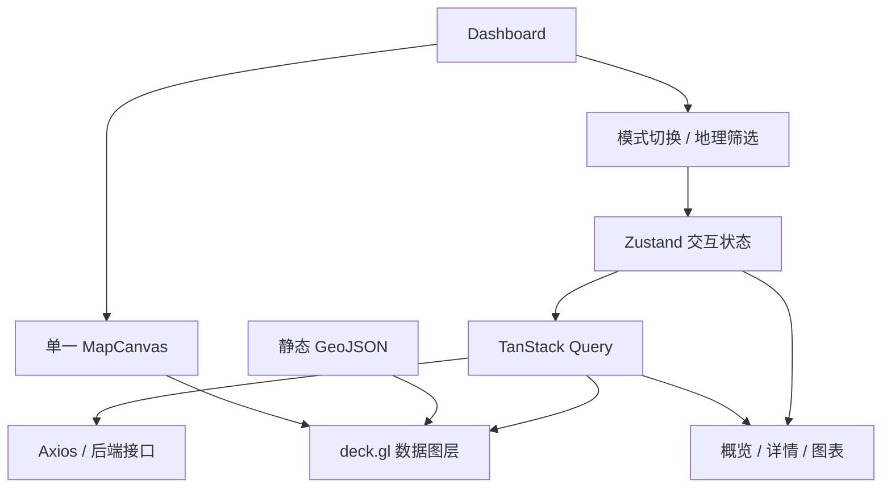

# 前端项目结构图

以下为本次搭建的实际结构。组件平铺，单组件内部的小块逻辑可保留在同一文件，不预建大量空目录。

```text
agri-llm-frontend/
├── docs/                          # 技术方案、结构和接入说明
├── public/
│   ├── favicon.svg
│   └── boundaries/
│       ├── world.geojson
│       ├── china.geojson
│       └── manifest.json           # 原型边界来源、哈希与使用限制
├── scripts/
│   └── import-boundaries.mjs       # 可复现的 GeoJSON 结构转换
├── src/
│   ├── api/
│   │   ├── request.ts              # Axios 唯一实例
│   │   └── dashboard.ts            # 地图、统计、详情、邻域请求
│   ├── components/
│   │   ├── DashboardHeader.tsx
│   │   ├── FilterBar.tsx
│   │   ├── MapCanvas.tsx           # 共用地图实例与局部相机状态
│   │   ├── AnalyticsPanel.tsx
│   │   ├── TrendChart.tsx          # ECharts 懒加载
│   │   ├── DetailDrawer.tsx        # 大弹窗按对象类型展示详情和证据
│   │   ├── AiAnalysisPanel.tsx
│   │   ├── LayerDrawers.tsx         # 事实/关联复用左右浮层与地图控件配置
│   │   └── MapActions.tsx           # 旧操作组，当前页面未使用
│   ├── pages/
│   │   └── Dashboard/
│   │       ├── index.tsx           # 页面编排
│   │       └── index.less          # 大屏布局和当前组件样式
│   ├── styles/
│   │   ├── globals.less
│   │   ├── variables.less
│   │   ├── mixins.less
│   │   └── antdTheme.ts            # Ant Design 6 ConfigProvider token
│   ├── utils/
│   │   ├── date.ts
│   │   ├── map.ts                 # 行政区相机计算
│   │   └── mapLayers.ts           # 边界、事实、实体、关系、粒子图层工厂
│   ├── hooks.ts                   # Query Hook 与查询上下文
│   ├── store.ts                   # UI 状态，不复制服务端数据
│   ├── queryClient.ts
│   ├── types/
│   │   └── index.ts               # 事实、粒子、实体、关系和查询类型
│   ├── App.tsx                    # AntD/Query 全局 Provider
│   ├── main.tsx
│   └── vite-env.d.ts
├── tests/core.test.ts
├── .env.example
├── .gitignore
├── .nvmrc
├── .oxlintrc.json
├── index.html
├── package.json
├── package-lock.json
├── tsconfig.json
├── tsconfig.app.json
├── tsconfig.node.json
├── vite.config.ts
└── README.md
```

## 页面与数据关系



后续较复杂组件的样式可在 `components/` 下增加同名 `.module.less` 文件，仍保持平铺。暂不引入 `features/`、全局路由和每组件一个目录；出现独立页面需求后再扩展。
